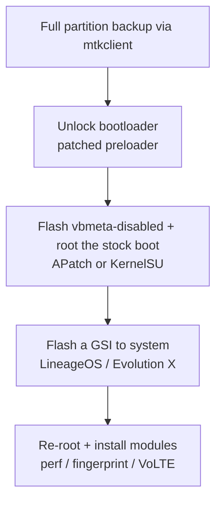

# Oppo A57 4G (CPH2387 / MT6765) — unlock, root, GSI, and fixes

Notes and tools for turning a stock Oppo A57 4G into a rooted GSI daily driver.
Everything here was worked out and tested on a real CPH2387 (Helio G35, 4 GB RAM,
stock Android 13 / ColorOS 13.1, kernel 4.19.191+).

> [!WARNING]
> Unlocking the bootloader **wipes the phone** and voids the warranty. A bad flash
> can soft-brick it. This chip (MT6765) is recoverable through BROM, but recovery
> takes a cable, a computer, and patience. Do a full partition backup **before you
> start**, and don't continue unless you understand each step. No warranty — you
> run this at your own risk.

## What's here

| Folder / file | What it is |
|---|---|
| [`UNLOCK.md`](UNLOCK.md) | Bootloader unlock recipe (patched-preloader method, the one that actually works on CPH2387) |
| [`docs/fingerprint-gsi.md`](docs/fingerprint-gsi.md) | Why fingerprint breaks on a GSI, and the HIDL-shim fix |
| [`docs/a17-upgrade.md`](docs/a17-upgrade.md) | Notes on moving to a newer Android GSI |
| [`docs/plan.md`](docs/plan.md) | Overall approach and ordering |
| [`perf/`](perf/) | Low-RAM performance + battery module (ZRAM, LMKD, governor, deep idle). Flashable zip |
| [`fp-hidl-shim/`](fp-hidl-shim/) | Fingerprint + face fix for GSI: HIDL descriptor patcher + module source |
| [`volte/`](volte/) | VoLTE/IMS method notes (which files to pull from your own stock ROM) |

The matching kernel build (KernelSU-Next on 4.19, GitHub Actions CI) lives in a
separate repo: **oppo-a57-mt6765-kernel**. A prebuilt, flashable
KernelSU-Next kernel is on its [Releases page](https://github.com/alok-debnath/oppo-a57-mt6765-kernel/releases/tag/v1.0-ksu).

## The short version of the flow

1. **Back up everything first** (especially `preloader`, `nvram`, `nvdata`, `nvcfg`,
   `boot`, `vbmeta`). These hold your IMEI and recovery images. Losing them is permanent.
2. **Unlock** — see [`UNLOCK.md`](UNLOCK.md). The official Oppo app does **not** cover
   global CPH2387; the patched-preloader route does.
3. **Root the stock boot** — patch `boot.img` with APatch (or a custom KernelSU kernel)
   and flash it. Root survives the GSI swap because it lives in `boot`, not `system`.
4. **Flash a GSI** to `system` (fastbootd). WiFi/BT/GPS keep working because the stock
   vendor modules still load against the in-place-patched stock kernel.
5. **Install the modules** here for performance, fingerprint/face, and VoLTE.

## What this repo does NOT contain (and why)

To keep it legal and safe, it ships **only original scripts and documentation** — no
proprietary blobs and no device secrets:

- **No boot images.** A patched boot carries the owner's root superkey. Patch your own.
- **No preloader.** That's Oppo's code and is per-device. Dump and patch your own.
- **No vendor binaries** (the fingerprint `.so`, VoLTE `.jar`/`.so`/`.apk`). These are
  Oppo/MediaTek proprietary — the tools here extract them from **your** phone instead.
- **No backups, IMEI, serials, or installed-app lists.**

So the fingerprint and VoLTE modules won't install until you drop in the matching files
pulled from your own device — each README says which, and from where.

## Credits

Built on the work of the LineageOS / Evolution X GSI teams, APatch and KernelSU-Next,
mtkclient, and the Shocked-Cat Oppo preloader-unlock tool. Thanks to all of them.

## License

Apache-2.0 (see [`LICENSE`](LICENSE)). The separate kernel repo follows the Linux
kernel's GPL-2.0.
